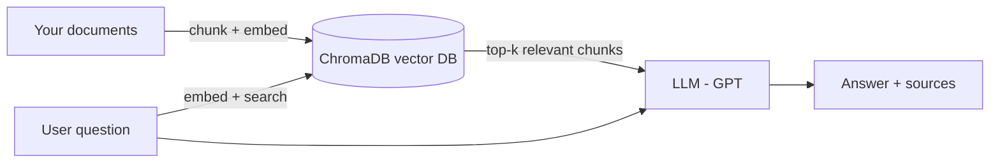

# 🤖 RAG Chatbot Starter (Python + OpenAI + ChromaDB)

> Chat with **your own documents** using **Retrieval Augmented Generation (RAG)** — a clean, minimal starter you can turn into a customer-support bot, internal knowledge assistant or website chatbot.


## ✨ Features

- 📄 **Ingest** `.md` and `.txt` files from the `data/` folder
- ✂️ **Smart chunking** with overlap, preferring paragraph boundaries
- 🧠 **OpenAI embeddings** stored in a local **ChromaDB vector database**
- 🔎 **Semantic search** to find the most relevant chunks for each question
- 💬 **Grounded answers** — the LLM answers only from your data and shows **sources**
- 🔁 **Follow-up questions** using recent chat history

## 🧠 How RAG works



## 🚀 Quick start

```bash
git clone https://github.com/adarsh0008/rag-chatbot-starter.git
cd rag-chatbot-starter
python -m venv .venv && source .venv/bin/activate   # Windows: .venv\Scripts\activate
pip install -r requirements.txt
cp .env.example .env        # add your OPENAI_API_KEY

# 1) Put your documents in ./data, then build the knowledge base
python app.py ingest

# 2) Start chatting
python app.py
```

Example:

```text
You: How long does a typical project take?
Bot: A standard website takes 2 to 4 weeks, and CRM or automation projects usually take 1 to 3 weeks.
Sources: data/sample-business-faq.md
```

## ⚙️ Configuration

| Variable | Default | Description |
|---|---|---|
| `OPENAI_API_KEY` | — | Your OpenAI API key |
| `CHAT_MODEL` | `gpt-4o-mini` | Model used to generate answers |
| `EMBED_MODEL` | `text-embedding-3-small` | Embedding model |
| `TOP_K` | `4` | Number of chunks retrieved per question |
| `DATA_DIR` | `data` | Folder with your documents |
| `CHROMA_DIR` | `.chroma` | Where the vector database is stored |

## 🧩 Ideas to extend

- Swap ChromaDB for **Pinecone, Qdrant or Supabase pgvector** for production scale
- Use **Claude, Gemini or Llama** instead of GPT
- Add **PDF, DOCX and website** loaders
- Wrap it in a **FastAPI** endpoint and embed it as a website chat widget
- Connect it to **GoHighLevel**, WhatsApp or a **Retell AI voice agent** so it answers customers automatically

## 👨‍💻 Need a custom RAG chatbot or AI assistant?

I'm **Adarsh Shukla**, an **AI automation expert and full-stack developer** with 11+ years of experience. I build **RAG chatbots**, **AI voice agents (Retell AI)**, **n8n automations** and **GoHighLevel** solutions for businesses and agencies.

[](mailto:adarshlkj@gmail.com)
[](https://github.com/adarsh0008)

---

⭐ If this helped you, please **star the repo** — it helps others find it!
